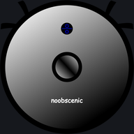
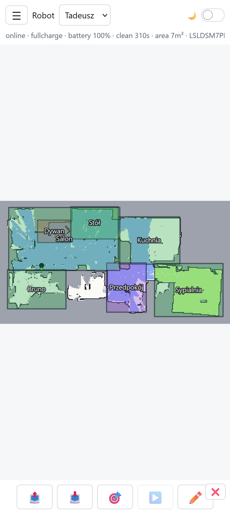
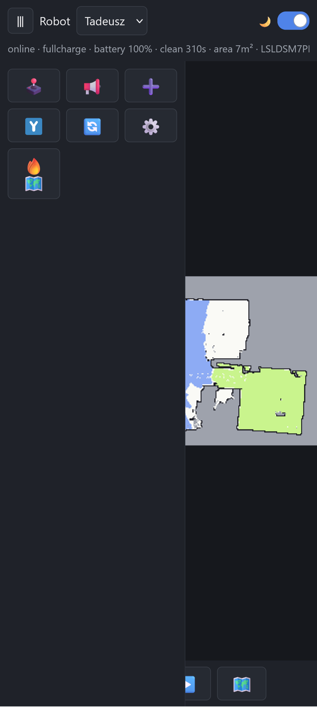

# noobscenic



A clean-room, reverse-engineered replacement server for the **Proscenic M7 Pro**
robot vacuum, written in Rust.

The goal is to re-home (pair) the robot to a server you control —
re-implementing the vendor cloud APIs and protocols — so it keeps working
without actually ever talking to the vendor cloud.

⚠️ The software assumes single household use and exposure to LAN only — it lacks
access control (authentication) or security features (HTTPS). **Run it exposed
to the internet at your own risk.** ⚠️

**Status: feature complete, in maintenance mode.**
Features:
- re-homing (pairing) of robots with a Python script,
- web UI for graphical control of the robots,
- REPL-like operator console,
- map & paths decoding and rendering,
- zone editing & cleaning dispatch,
- direct remote control (steering),
- spot cleaning around the robot's current position,
- Y-shaped mopping,
- SQLite persistent storage,
- ✨ **New, not present in original app:** ✨ zone types (regular, deep clean,
  no-go, no-mop, no-vacuum),
- ✨ **New, not present in original app:** ✨ placed spot cleaning (indicate a
  spot to clean from the map)

ℹ️ *The web UI is run from the server itself and is mobile-friendly. No separate
mobile app is planned.*

 

## Usage guide

### Prerequisites

- A machine (server) that is reachable from the robot's LAN and keeps the same
  address between sessions: a DHCP reservation, a static IP, or a DNS name, with
  two TCP ports open for incoming connections (**8080** and **8081** by default,
  configurable). The robot is configured with this address at re-homing
  (pairing) time and will keep dialing it.
- Rust (stable) to build the server; Python 3 (standard library only) for the
  re-home tool.

All state lands in the data directory (`./var` by default): `noobscenic.db`
(SQLite), `traces/` (wire captures) and `logs/`.

### 1. Building

See [BUILDING.md].

### 2. Running the server

Being a Rust project, you may use Cargo:

    cargo run -- --data-dir ./var

Or just invoke the executable (`noobscenic` or `noobscenic.exe`, depending on
platform. Call it with `-h` for command-line parameters.

The server listens by default on `0.0.0.0:8080` and `0.0.0.0:8081` (i.e. ports
8080 and 8081 on all network interfaces the machine has).

To change settings, copy `config.example.json` to `config.json` (it is read from
the working directory; unknown keys are rejected). Every key is optional and
omitted keys use their defaults; the example stays small, while
[the configuration section](#5--configuration) lists every
setting. The most likely changes are `http.bind` / `gateway.bind`,
`gateway.encrypt_commands` (allows `encrypt:1` command encryption),
`logging.wire` (what gets captured), `console.enabled`, and `runas.user` /
`runas.group` (POSIX builds with the `posix-runas` feature drop root to that
account before they create any file). The SQLite database always stays in
`data_dir`.

### 3. Using the server

Noobscenic's stdin is an operator console when it is a terminal — `help` lists
the verbs, and `devices`, `events`, `commands` and `send` are the ones you will
use most. Logs go to stderr and to `var/logs/noobscenic.log`. The same verbs
exist as one-shot CLI commands (`noobscenic devices`, `noobscenic send …`),
which work from a second terminal (when invoked with the same configuration) and
share the database with the running server.

The same port also serves a web UI: open `http://<http.bind>/`
(`<server-address>:8080` by default) on your phone or desktop and pick the robot
in the top bar — the choice lands in the URL (`?id=…`), so a robot is a
bookmarkable page. The map redraws as the robot sends telemetry, the last clean
path is drawn over it, basic functionality is accessed via the bottom bar
buttons, and more advanced functionality is exposed via the hamburger menu in
the top left corner.

There is **no authentication**: anyone who can reach port 8080 can drive the
robot.

### 4. Re-home (pair) the robot

1. Start the server first (above), then put the robot into pairing mode and join
   this machine to the robot's own open Wi-Fi — the network name begins with
   `Proscenic-`.

2. Run:

       python tools/rehome.py --server-host <server-address> \
           --ssid <target-wifi-ssid> --pwd '<target-wifi-password>' --userid <any-id>

   The tool finds the robot's UDP port, points its cloud URL and push gateway at
   `server-address`, arms the bind, stores the Wi-Fi credentials and commits the
   configuration. `--dry-run` prints the datagrams instead of sending them;
   `--port 7913` skips the port sweep on this model.

3. The commit disables the robot's soft-AP, so reconnect this machine to your normal
   Wi-Fi. The robot joins the target network and dials the server.

#### Signs that it worked

Open the web UI and see the robot listed, maybe inspect the identity section
inside the settings. It's ready to be commanded.

Alternatively, with the operator console:
- The server log shows the channel-B handshake (`channel-B handshake; device online`).
- `devices` shows the robot `online`; `device <sn>` shows its session and, once the
  preBind has been answered, `bind state bound`.
- `events <sn> 5` shows the last things the robot said.
- Send something harmless: `send <sn> 21018 {}` (firmware version), then
  `commands` — the row should walk `pending` → `sent` → `acked` within a second or two.
- A whole cycle: `send <sn> 21005 {"mode":"smartClean"}` starts a clean,
  `send <sn> 21017 {"cmd":"stop"}` ends it, and `send <sn> 21012 {"cmd":"start"}`
  sends the robot home.

### 5. Normal use

Open the `<http.bind>` address in a browser.

## Configuration

Single JSON file, path from `--config` (default `./config.json`); missing file =
all defaults. CLI flags (`--data-dir`, `--http-bind`, `--log-level`,
`--no-wire-trace`) override it; `RUST_LOG` overrides the log filter (levels and
target directives; no regexes). Every key is optional; omitted keys use the
defaults in the table below. `config.example.json` is deliberately a small
starter file, not an exhaustive reference.

```json
{
  "data_dir": "./var",
  "http": { "bind": "0.0.0.0:8080" },
  "gateway": { "bind": "0.0.0.0:8081" },
  "logging": { "level": "info" }
}
```

| Key | Default | Meaning |
|---|---|---|
| `data_dir` | `./var` | Root for the SQLite file, application logs and wire traces. |
| `database.max_connections` | `2` | SQLite pool size; must be at least 1. |
| `http.bind` | `0.0.0.0:8080` | Channel-A and web-UI listener. |
| `gateway.bind` | `0.0.0.0:8081` | Channel-B push-gateway listener. |
| `gateway.advertise` | `null` | Address list returned by `getSockAddr`; `null` auto-detects from the robot's peer address. |
| `gateway.ping_timeout_secs` | `120` | Idle timeout for a channel-B connection. |
| `gateway.max_frame_bytes` | `8388608` | Maximum channel-B frame accepted by the decoder. |
| `gateway.ack_handshake` | `true` | Acknowledge the robot's channel-B handshake. |
| `gateway.announce_app_online` | `true` | Mark the app online in `21006` pongs so the robot pushes status and maps. |
| `gateway.encrypt_commands` | `false` | Allow `encrypt:1` commands. |
| `gateway.command_ttl_secs` | `300` | Expire queued commands older than this instead of firing them later. |
| `console.enabled` | `true` | Enable the stdin operator console when it is compiled in. |
| `runas` | `null` | Drop root to `runas.user` and optional `runas.group` on POSIX. |
| `registration.accept_all` | `true` | Adopt unknown devices; `false` accepts only serials already in the database. |
| `registration.session_ttl_secs` | `null` | Session lifetime; `null` means sessions never expire. |
| `logging.level` | `info` | Default tracing filter, also settable with `--log-level` or `RUST_LOG`. |
| `logging.file` | derived path | Application-log path; `false` disables the file, and `null` uses `<data_dir>/logs/noobscenic.log`. |
| `logging.wire.enabled` | `true` | Enable wire tracing when the build has a sink. |
| `logging.wire.dir` | derived path | Trace directory; `null` uses `<data_dir>/traces`. |
| `logging.wire.format` | `both` | `jsonl`, `raw` or `both`. |
| `logging.wire.max_body_bytes` | `262144` | Truncate larger bodies in JSONL traces; `0` keeps them whole. |
| `logging.wire.rotate_mb` | `64` | Rotate JSONL files at this size; `0` never rotates. |
| `logging.wire.retain_days` | `14` | Delete trace files older than this; `0` keeps them forever. |
| `logging.wire.redact_secrets` | `false` | Mask `session`, `cookies` and `sig` in JSONL traces. |

* `gateway.advertise` is what `getSockAddr` hands the robot, as
  `data.addr_list:[{ip,port}]`. It **must be an address the robot can reach**, not the
  bind address. `null` = auto-detect: open a UDP socket, `connect()` it to the
  requesting peer's IP, read back the local address. Explicit form:
  `[{"ip":"192.168.1.10","port":8081}]`; multiple entries are allowed, the device
  iterates the list.
* `registration.session_ttl_secs: null` = sessions never expire. Setting it makes the
  server answer `code:102` after the TTL, which is the documented way to force a
  re-register — useful for exercising that path on purpose.
* `gateway.announce_app_online` (default `true`) makes the `21006` pong carry
  `"isExistConnect":true`. That is the pong the device both accepts *and* acts on:
  without the integer `encrypt` the frame is dropped at the inbound gate, and
  without the flag the robot never pushes status or map uploads.
* `runas` names the account the server becomes when it is started as root — the
  router/NAS deployment. `group: null` uses the user's primary group from
  `/etc/passwd`, and an unknown user or group is a startup error. The object
  parses in every build, but only a build with the `posix-runas` feature
  (POSIX-only, deliberately not in `default`) acts on it; without the feature
  the server warns and keeps the current user, so one config file stays valid
  across builds. The switch happens before the log file and the data directory
  are created, so everything the server writes belongs to that account — which
  also means both listeners must be on unprivileged ports (the defaults are).
* The SQLite file always follows `data_dir`; there is no separate database address
  to keep in sync. Listener TLS and firmware OTA have no configuration keys until
  those features exist.

## Troubleshooting

If the rehoming tool reports no robot, check the robot is in pairing mode and
this machine is on the `Proscenic-` network, not still on its normal Wi-Fi.

If nothing reaches the server after the switch, check the firewall — a missing
inbound "allow" rule, or a "deny" rule, can drop the robot's packets silently.
The default ports are 8080 and 8081, TCP.

If the robot stops reaching the server later, its configured `server-address`
may have changed: use a DHCP reservation, a static address, or a DNS name.

## Backing out

- **Stop the server** — console `quit`, or Ctrl-C. The robot keeps working from its
  own panel; you lose the app-style control, telemetry and maps until it is re-homed.
- **Move it to another server**: re-run the re-home tool with the new address.
- **Hand it back to the vendor app**: put the robot back into pairing mode (its
  Wi-Fi reset; see the vendor manual) and re-add it with the app. The app's
  add-device flow re-provisions the cloud URLs and Wi-Fi the same way the re-home
  tool does; the binding noobscenic recorded lives only in `var/noobscenic.db`.
  Whether the vendor cloud accepts the device again depends on its own record — if
  re-adding is refused, a factory reset clears the robot side.
- **Forget everything we stored**: delete `var/`.

## Not yet implemented (perhaps deliberately postponed)

Protocol analysis and reverse-engineering artifacts live in [`doc/`](doc/).

Planned, but not a priority at the moment:

- Scheduled cleaning. Not a feature I ever wanted myself.
- `noobscenic trace <file>` — rendering a wire capture as a readable timeline.
  Cool, but not exactly necessary.
- `--replay` — feed a recorded capture back into a fresh server as a regression
  test. Same as above.
- TLS on the listeners — only useful for a DNS-override deployment that
  impersonates the vendor hostname. The robot validates no certificates, so a
  self-signed cert would do, and the re-homed path needs none of it.
- Exploit for uploading a homebrew firmware. Needs security research.

See [`doc/PLAN.md`](doc/PLAN.md) §14 for what these would look like.
